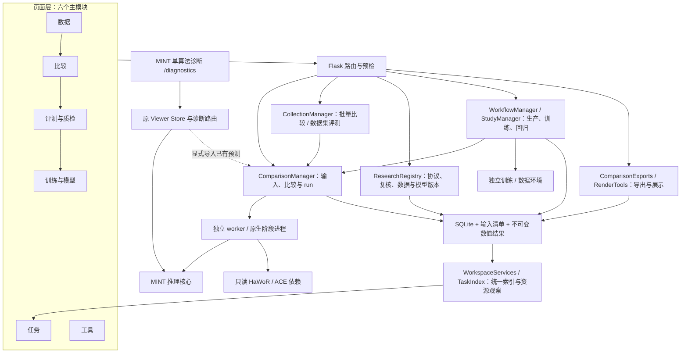

# Architecture

MINT keeps inference and training modular and exposes the redistributable parts
of the research data pipeline as an implementation reference.

当前增强平台在这些研究组件之上提供统一工作台。页面功能地图与操作衔接见
[模块与流程](modules-and-flow.md)；本页区分页面、服务、执行器和数据边界。
以下描述依据仓库实现，不表示所有可选后端、数据资产或多机环境均已部署验收。

```text
Approved videos
      |
      v
Locally integrated Ray pipeline -----> LeRobot v3 dataset
      |                         |
      |                         v
Optional research backends   Training engine -----> Checkpoint
                                                   |
                                                   v
                                      Prediction engine
                                         |       |
                                         v       v
                                      NPZ data  Web viewer
```

## 当前增强平台架构

主入口 `/` 跳转到 `/compare`。同一主工作台有六个一级模块：**数据、比较、
评测与质检、训练与模型、任务、工具**。`hub`、`research_tab`、`id` 等 URL
参数选择持续工作区或已保存记录，不代表额外服务。MINT 单算法诊断有独立入口
`/diagnostics`，与主工作台共享 MINT 推理实现，但维护独立配置和结果状态。
顶部“功能流程”打开说明弹窗，并可跳转到现有模块 / 训练视图；它既不是新增
主模块，也不提交计算。数据目录的下一步同样只把已选产物带入可核对的配置。



图中的管理器、索引、GPU 租约与缓存是后台服务层，**不是第七个页面模块**。
它们在同一应用中协调线程、持久状态与自有子进程；不应据此理解为已部署的
独立微服务或跨后端常驻模型服务器。

| 层次 | 主要代码 | 职责与边界 |
| --- | --- | --- |
| 页面与导航 | `mint/comparison/web/` | 六模块导航、独立表单草稿、比较播放、上下文与深链接；切换模块不提交推理或训练 |
| HTTP 接口 | `mint/comparison/api.py`；`eval/model_effect/visualization/viewer/routes.py` | 主工作台与诊断路由、参数验证、显式操作入口；能力清单不加载推理框架或创建模型 worker |
| 输入与执行身份 | `comparison/jobs.py`、`prepare.py`、`datasets.py`、`native_sources.py` | 冻结源文件、视角、帧协议、标定及后端身份；共享输入准备；只把同一输入协议的结果加入同一比较 |
| 原生执行 | `comparison/worker.py`、`native.py`、`native_pool.py`、`native_tasks.py` | 在独立进程调用 MINT、HaWoR、ACE；保存阶段状态；外部算法根目录作为只读依赖 |
| 几何交换 | `comparison/contracts.py`、`normalizers.py`、`results.py` | 标准化、校验、发布与读取数值几何；导入已有结果只解码 / 归一化，不补算原网络推理 |
| 多输入与研究闭环 | `collections.py`、`quality.py`、`annotations.py`、`research.py`、`workflows.py`、`studies.py` | 批次、评测、质检、人工记录、数据版本、训练、固定协议与模型门槛；操作须明确选择输入并提交 |
| 展示与导出 | `exports.py`、`tools.py` | 从已有结果生成同步比较视频、MuJoCo 或 Wuji Hand 展示，不覆盖原始预测 |
| 观察与资源 | `workspace.py`、`task_index.py`、`observability.py`；`mint/inference/gpu_scheduler.py`、`cache_budget.py` | 统一任务查询、阶段事件、资源统计、协作式租约和缓存预算；源执行器仍是任务状态依据 |

## 状态与产物关系

默认持久根目录为 `.cache/comparison`，可通过 `MINT_COMPARISON_DIR` 指定。
`jobs.sqlite` 保存比较、run、批次、工作流、研究记录及统一任务索引；
`inputs/<sample_id>/sample.json` 保存准备后的时间线，
`runs/<run_id>/request.json` 保存执行请求。原生中间文件、日志和进度与 run
关联；完成几何以 `runs/<run_id>/result/result.json` 和数值 `.npy` 发布。
模型权重与训练数据另有来源路径，不要求复制到该根目录。

- **比较（comparison）是对照记录**：引用一个输入协议和一组 run。
  它可附加已有结果、导入 GT、选择画面基准或组合相机；比较本身不等于一次执行。
- **run 是算法 / 导入 / 组合结果的身份**：原生 run 记录后端代码、资产与数值
  参数；相同身份可在多个比较中引用。完成结果不可原位修改，变更产生新身份。
  相机组合会产生带组件来源的新结果，不能冒充原生算法输出。
- **任务是执行与观察记录**：可对应推理 run、批次、评测、训练、展示或导出。
  一个比较可包含多个算法任务，一个批次可产生多组比较；任务索引不代替执行器。
  共享 run 的批次取消须保护其他比较，不能把“取消一个批次”解释为停止全部引用。

标准几何以米为单位、OpenPose21 关节顺序、左右手两个槽位和 OpenCV 相机坐标
交换。它保留源帧索引、时间戳、内参、几何有效性；世界相机与 MANO 网格仅在
结果实际具备时提供。缺失几何为 NaN 并带有效性掩码，不能用零值或单位相机
制造成功结果。数组写入完成后才原子发布 `result.json`，读取时核对文件身份。

## 模块之间的闭环与语义边界

典型链路是“数据选择 / 原生接入 → 预检并提交 → 比较 → 指标与逐帧复核 →
不可变筛选清单 → 显式格式转换 / 伪标签生产 → 训练 → 完整检查点 →
固定协议回归 / 离线评测 → 模型登记与别名”。每个箭头代表可用的下一步，
不是自动串行流水线；任务页跟踪这些实际执行，工具读取各自选择的输入。

必须保留以下不同含义：

1. **声明 GT 与画面算法基准不同。** `reference_role=user_declared_ground_truth`
   是来源声明，不是平台对标注质量的认证。普通算法被固定为显示基准后仍是预测；
   无声明 GT 的两算法指标只表达差异。参考 GT 不自动转为算法输入内参，显式
   标定单独冻结在输入协议中。固定离线协议要求每个输入恰有一个声明 GT。
2. **二维人工修正不是三维 / MANO GT。** 修正保存像素点、可见性、左右手映射、
   来源身份和父版本；当前标记 `training_eligible=False`，不会回写原始几何。
   接受一个复核片段也只是筛选决定，不产生额外真实标注。
3. **伪标签不是实际监督真值。** 复核相机导出保留“模型生成”角色，且仅提供
   相机监督；原生 MINT 生产可导出相机与 MANO 伪标签，但需要完整原生预测及
   明确来源。训练伪标签必须显式允许 `allow_pseudo_labels`；二维修正不会为
   这些路径补造真实 MANO 或三维标签。
4. **模型别名不是热加载。** 登记权重仅建立版本；发布需匹配原生离线评测、
   文件与推理配置身份、误差 / 覆盖门槛及已声明数据重叠检查。通过后更新可选
   检查点别名；不替换默认权重文件，不修改已运行 worker。回滚仍要重新核对证据。

目录按产物能力提供衔接：原生样本进入比较配置，可训练版本进入训练配置，
复核筛选清单进入 `curate_dataset` 导出配置，固定协议进入离线评测 / 回归，
原生评测报告进入发布门槛视图。发布复核清单后仍须显式导出，发布模型别名后
仍须显式配置新比较。相关异步返回需核对当前导航与选择，避免覆盖用户后来
切换的页面或参数。

预检可读取元数据、检查文件、依赖、标定及资源条件，不能保证输出质量。
原生数据目录清单是目录与基础格式检查，不是递归内容认证。固定协议离线评测
读取已有结果，回归 / 性能试验则可显式启动新的原生运行；两者不应混为一次
公开论文 Benchmark 复现，也不提供未测量的冷启动或加速结论。

## 执行、恢复与资源边界

Web 服务协调执行，不在请求进程中直接持有所有算法模型。MINT 使用有界窗口
与恢复缓存；HaWoR、ACE 由各自原生适配器处理。后台按交互、批量、后台优先级
与 GPU 余量申请协作式租约，在可恢复窗口 / 阶段边界让步。GPU 上限、可调度
数量和实际运行数量分开；连续 SLAM 有时序依赖，不保证线性多卡加速。

`exact` 按身份复用；`compatible` 校验输入、后端、数值选项和已发布文件后
引用既有原生结果；`fresh` 建立新身份并关闭相关跨运行预测复用。共享 RGB
准备仍独立存在。复用结果的原耗时不代表本次冷运行耗时。

恢复按执行器处理：原生推理按明确恢复复用完整阶段；批次可继续未完成项；
持久同步视频导出可在死进程后从帧零重放完整请求；训练使用完整检查点显式
续训。取消的导出不会因重启自动再跑。任务索引不会因心跳陈旧直接判失败或
终止外部进程。阶段 ETA 只表达当前阶段估算，不是整条流程完成承诺。
固定集试验恢复按冻结算法、后端版本和选项找回预测 run；声明 GT 留在比较中
作为协议参考，不进入候选预测列表。失败 / 尚无结果的预测仍保留失败与覆盖
语义，不能通过只恢复成功产物抬高评测表现。

多机配置的校验与保存已有实现；跨物理机器 NCCL、共享存储与实际环境仍需
专项验收。页面保存配置不申请云资源，不自动启动远程集群。

## Boundaries

### Data plane

`ego_pipeline/` contains the repository-owned scheduling, actors, resumable
manifests, monitoring, and LeRobot export code. Its `backends/` package defines
interfaces for optional upstream research models, and its `data_cleaning/`
package contains trajectory filters used before export. A public checkout is
not a complete production data generator until the user supplies and integrates
the required upstream backends locally.

Redistributable backend source snapshots live under `third_party/`, together
with their upstream licenses and provenance manifest. They are not sufficient
to recreate every production adaptation. Model weights, MANO files, generated
extensions, and upstream Git histories remain outside the MINT source release.
The MINT-adapted HaWoR infra copy exists only on the development machine and is
Git-ignored because CC BY-NC-ND 4.0 restricts commercial use and prohibits
redistribution of modifications.

### Training plane

`model_train/` is a configuration-driven PyTorch and Accelerate stack. A small
registry constructs the dataset, model, and loss objects. The public build
includes the primary LingBot-Map student and excludes cloud-vendor submission
logic, private dataset mixtures, credentials, and experimental model variants.

### Inference plane

`mint/inference/` reuses the exact training preprocessing and model constructor.
It supports bounded windowed inference and saves only prediction arrays. The
renderer decodes predicted camera and MANO values without loading annotations.

### Viewer boundary

The original `eval/model_effect` Viewer starts at the configured sample root
and deliberately provides server-side directory browsing, including parent
navigation. Treat it as a trusted local research tool: use SSH forwarding or
an authenticated reverse proxy, and do not expose it directly to an untrusted
network. Its Benchmark panel and the standalone benchmark CLI share the same
evaluation implementation.

## Design principles

1. Portable paths are resolved from the repository, never a developer home.
2. Credentials arrive through the runtime environment, never tracked files.
3. Dataset and checkpoint licenses remain explicit installation boundaries.
4. Long videos preserve all source frames by default; decoding and window preprocessing are bounded, with persistent window checkpoints and cache budgets.
5. Prediction visualization is independent of ground-truth data.
6. CLI, Viewer and Benchmark share one inference core; model generations and source fingerprints isolate results.
