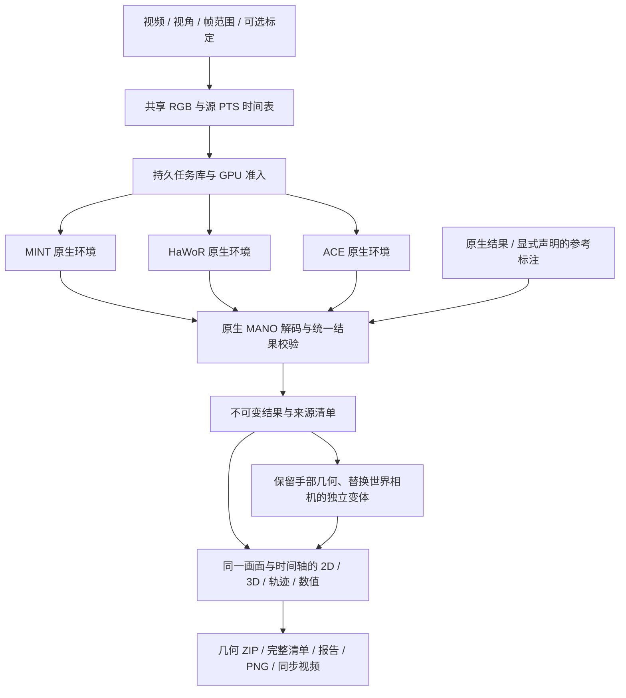

# MINT、HaWoR、ACE 统一推理与比较平台

主工作台为 `/compare`，单算法诊断位于 `/diagnostics`，`/` 跳转主工作台。同一个视频只建立一份解码后的 RGB、源帧号与 PTS 时间表；每套算法在自己的 Python/CUDA 环境里运行，通过经过校验的数值文件交换结果。平台没有合并三套权重，也没有更改原生网络或训练过程。



## 运行变体

| 变体 | 输出与输入要求 | 序列行为 |
|---|---|---|
| MINT | 双手 MANO、相机、存在性；默认使用生产平滑参数 | 保留原有窗口推理、拼接和共享 GPU 调度；无默认总帧数截断 |
| HaWoR Full | 检测、跟踪、相机系手部、DROID-SLAM、Metric3D 尺度、世界补全 | 保留全部选中帧；世界阶段失败时发布明确标记的相机系部分结果 |
| HaWoR Camera only | 检测、跟踪、相机系 MANO | 不运行世界阶段；不会填造相机轨迹 |
| ACE K-free | 模型预测内参、相机系 MANO、2D/3D 存在性 | 默认独立 81 帧 VAE 片段，首尾锚定、覆盖全部帧，明确区别于整段 VAE |
| ACE K-given | 与 K-free 独立的模型；需要显式针孔标定 | 同上，记录外部标定来源 |
| Reference | 仅导入标准几何，声明来源、坐标、米制单位及帧映射 | 不执行模型；声明不代表平台验证过标注质量 |

ACE 的 `native_tiled` 模式保留原生整段 VAE 与 `4k+1` 长度规则。例如输入 118 帧时输出 117 帧，任务标记为 `partial`，最后一帧显示缺失。默认 `independent81` 模式通过原生片段合并扩展处理长序列，不把它标成原生整段结果。短于 81 帧时应显式选择原生模式，平台不会补帧。

HaWoR 默认工作宽度 832，可显式设为 0 使用原尺寸。MINT 适配层按原生独立 16 帧分组分发手部任务，保留最后一组重复末帧的规则；检测跟踪和 SLAM 保持顺序。掩码采用与原生渲染 alpha 等价的批量光栅化，并以布尔值合并，避免完整序列的 float64 掩码中间量。SLAM 缓冲及因子图状态按实际关键帧数扩容，显存不足时明确保留部分结果。所有选中帧均保留，网络、MANO、SLAM、尺度及补全仍调用外部项目的原生实现。

默认原生后端最多使用 8 张 GPU。ACE 独立片段、HaWoR 手部与 Metric3D 关键帧可以多卡分发；原生整段 ACE VAE、HaWoR 连续检测和 SLAM 等阶段仍有顺序依赖。页面显示每阶段的实际卡数与并发峰值，上限不表示每个阶段都会同时使用 8 张卡。

HaWoR Full 的 SLAM 包含逐帧跟踪、原生 7+12 次全局优化和所有帧的相机轨迹补全。界面分别显示这些阶段的进度，之后还有 Metric3D 深度、尺度恢复及世界系补全。一次完整长视频测试中，10428 帧总工作进程耗时 2006 秒，其中 SLAM 1822 秒、深度预测 89 秒、世界补全 25 秒；不能因其他变体先完成就认为该阶段在等待空闲 GPU。

SLAM 运行时会预取最多 4 帧的原始 CPU 解码结果，使跟踪计算与读取重叠；轨迹补全保留原生读取方式。求解器、关键帧阈值、图像网格、8 个关键帧一组的 BA 批次以及 7+12 次迭代均保持原值。磁盘有足够余量时，SLAM 深度检查点使用无压缩 NPZ，减少单核压缩时间，保留每个数值；磁盘余量不足时回退到无损压缩。

完成的 SLAM 检查点可以跨任务复用，但要求输入、标定、原生源码、权重、解释器和配套手部掩码一致。迁移仅接受已审查的前一适配器版本，其他未知版本不适用。同一个任务修改 GPU 上限或资源策略时可跳过已验证的整段 SLAM。页面对窗口缓存、阶段复用及导入分别标识，命中缓存的耗时不能当作冷启动推理速度。

## 批量比较

多个视频或 Episode 使用同一套算法设置，每个输入分别保存比较结果。入口采用“核对输入清单 → 设置统一协议 → 预检与提交”；GT 与已知内参独立选择，预检不启动推理，提交会核对被冻结的文件与算法条件。详见 [批量比较：操作与执行边界](batch-comparison.md)。

## 页面使用

页面沿用原 WUJI EGO 工作台的深绿底色、黄绿操作色与编号配置卡片。左侧只放任务历史，可按视频、算法或状态筛选；输入参数在弹窗内设置，主区域分为“联动查看”“指标分析”“结果管理”。在 Mac 小窗口中，历史变为可收起的抽屉；窄屏逐列查看结果，播放条固定在底部。

1. 点击右上角“新建比较”，在“输入目录”中浏览服务器实时文件：点击文件夹进入、点击路径层级或“上一级”返回，点击视频后自动选中完整路径。可按名称筛选；窗口打开且页面可见时每 5 秒刷新，也可手动刷新。浏览和选择不提交推理。展开“直接定位路径 / 选择已有样例”可粘贴目录、视频路径或选择样例；“定位”返回已选视频所在目录。LeRobot 可切换到“Episode / GT”输入，读取根目录后选择相机流与 Episode；起始帧解释为 Episode 内位置。GT 参考与算法输入标定独立勾选，不会自动将 GT 内参提供给 K-free 算法。普通视频仍按文件夹浏览。随后选择完整画面或双目左/右眼。目标 FPS 为 0、最多帧数留空时处理全片。起始帧按原视频帧号解释。“输入与参数”沿用当前输入创建新比较，不会覆盖已有结果。
2. 勾选算法，在“运行参数”中选择片段策略、工作尺寸、平滑及资源策略。K-given 必须填写相机 JSON；K 对应原始完整视频网格，包含 `K`、`width`、`height`、`source`。双目右眼标定的主点也必须以该完整网格表达。
   每种原生算法都可设置 1–8 张 GPU 上限；实际卡数随可用显存、其他任务、协作租约及当前可并行任务数变化。
3. 点击“开始比较”后可离开页面。历史任务保存在 SQLite 中。每个算法可以独立查看阶段、GPU 并发、日志、取消与恢复；“详情”展开来源和工作尺寸，不挤压各列画面。相同输入、代码、权重和参数的任务复用同一 run。
4. “联动查看”支持 2D + 3D、只看 2D、只看 3D，切换时保留当前帧。默认优先显示三个不同算法家族；“显示结果”可勾选其他变体，“对照基准”固定首列但不改变 GT 角色；“A/B 对照”只显示基准和另一份结果。“单列放大”临时展开某个结果，“返回对比”恢复选列，保留基准、帧位置与选择。选择保存在浏览器中，新增加入的结果自动显示。单个结果的 2D/3D 左右展开；超过三份可见结果在工作区内滚动。底部时间轴、逐帧按钮和速度控制同时驱动各列，跳帧框使用从 1 开始的样本位置；同时显示从 0 开始的源帧号及原始时间。各列从一个解码画面复制背景，避免多个播放器各自漂移。2D 使用每个算法自己的 K；“3D 坐标”只切换三维和腕点数值，可以拖动旋转、滚轮缩放，使用共同米制比例。轨迹默认关闭，勾选后按需读取，即使当前帧已缓存也会独立检查轨迹。通常只读取可见结果；启用基准叠加或逐帧诊断时，还会按需读取被隐藏的基准。截图使用可见选列；视频导出默认包含全部结果，也可在导出配置中选择当前可见结果、网格/骨架和基准叠加；比较报告仍包含全部结果。“专注查看”收起顶部和历史区域，Esc 退出。输入框及弹窗内不会触发全局播放快捷键。
5. 世界比较使用首个共同有效相机帧重置坐标，保留算法间尺度差。如果没有共同有效相机帧，页面明确显示不可比较；ACE 自身没有世界相机。
6. “指标分析”在打开时按需计算共同有效帧上的差异，按覆盖与有效性、手部几何、时间稳定性、相机轨迹分组。默认只看当前选列与基准的配对，也可切换全部结果两两比较。表格逐行注明算法差异或相对声明 GT 的参考误差，保留 API 中的 A/B 顺序、单位、原始尺度、SE3/Sim3 与缺失值；不以 0 代替不可计算的值。切换显示范围不重算模型。“结果管理”可加入已有同输入结果、查看运行协议和导出报告；相机组合放在默认折叠的“高级实验”中。生成独立结果，手部相机系几何和 K 保持原值，只替换外参来源。可用 ACE + MINT camera、ACE + HaWoR camera 等方式比较组件影响。
7. 几何 ZIP 包含完整逐帧 NPY 与来源清单；比较报告保存元数据和数值，“保存当前画面”按当前布局生成 PNG，同步视频在后台按全部样本帧生成。视频中的存在性显示选项继承导出时的勾选状态，保持完整样本时间轴。左下“导入结果”打开带格式校验的导入面板，输入协议与新建比较共用。

每个卡片摘要展示实际运行策略和主要参数。“运行协议与来源”提供全部结果的工作网格、后处理、相机与内参来源、资源策略、输入协议、实现版本和完整来源清单链接。MINT Production（q/r/beta 0.6/0.6/2）与 Viewer（0.7/0.5/0.3）明确区分；导入与相机组合标明使用已有数值，不把继承的 GPU 参数当成新推理。显示选列、基准、放大和指标范围都是查看设置，不修改历史结果或推理协议。

只为轨迹显示进行最多 1500 点的抽稀；存储的数值、数值指标与导出视频不受该显示抽稀影响。视频代理与同步导出使用恒定播放帧率，每个播放帧对应一个选中源帧；精确源时间使用清单中的 PTS，尤其是可变帧率输入。

## 结果协议与比较边界

每个 run 的 `result/result.json` 最后原子发布，记录代码内容摘要、原生环境版本、权重及输入文件身份、参数、时间与各数组身份。主要数值为：

| 字段 | 形状 | 语义 |
|---|---|---|
| `joints_camera_m` | T × 2 × 21 × 3 | OpenPose21，左/右固定顺序，光学相机系，米 |
| `vertices_camera_m` | T × 2 × 778 × 3 | 使用各算法原生 MANO 解码得到的顶点 |
| `geometry_valid` | T × 2 | 有限几何；缺失手的点必须为 NaN |
| `source_frame_indices` / `timestamps_s` | T | 原视频帧号 / 原视频 PTS 秒 |
| `K` | T × 3 × 3 | 原始选中画面的零斜切针孔投影矩阵 |
| `T_world_camera` / `pose_valid` | T × 4 × 4 / T | 可选的真实相机外参及有效性；不使用单位阵替代缺失相机 |
| `presence` / `confidence` | T × 2 | 可选的存在性判断 / 原生概率，保留其算法语义 |
| `tracked` / `filled` | T × 2 | 可选的跟踪 / 世界补全标记，不能当作检测置信度 |

腕点取解码后的 MANO/OpenPose21 第 0 点。MANO 参数中的平移通常不等于腕点；平台不把二者直接混用。ACE 的直接预测关节与 MANO 解码关节也不同，本工作台的统一几何采用 MANO 解码结果，原生直接预测保留在阶段文件中。

没有声明 GT 时，数值仅表示算法之间的差异。指标包括相机系关节/腕差异、腕对齐和逐手逐帧 Sim3 对齐差异、各自 K 下的重投影差异、腕速度差异、覆盖与缺失，以及世界相机的首帧对齐差异、SE3/Sim3 ATE 和共同有效时间间隔的 RPE。原始尺度误差与拟合尺度结果分别保存。均值使用共同有效几何，不用存在性阈值暗中删去困难预测。它们不是未经验证的精度排名。

## 原生导入与复用

展开“导入已有算法结果”，沿用上方输入设置并给出文件、格式、来源说明与样本相对位置 `frame_map`。支持 MINT NPZ、HaWoR 世界 NPZ、ACE PKL、标准几何 NPZ。HaWoR 还必须提供原生图像网格 `[width,height]`。ACE Pickle 只允许配置的 ACE `results` 目录内受信任文件。其余 NumPy 文件禁止 object/pickle 数组。

旧结果往往没有输入身份，帧对应和来源需要导入者明确声明，平台不能从旧文件自动证明原始 RGB 和标定完全一致。导入记录会保留该边界，耗时仅包含导入/解码，不冒充原始推理速度。

“加入已有结果或 GT”只列出样本身份相同的 run，可把不同时间运行的模型、导入结果和参考标注加入同一次比较。正在查看相同样本时，新导入结果也会自动追加。

## 资源、恢复与部署

默认部署依赖三个现有目录，不把依赖和模型复制进本仓库：

```text
/data1/lizhen_algo/mint/.venv/bin/python
/data1/lizhen_algo/hawor/.venv/bin/python
/data1/lizhen_algo/ace_ego_hand/.venv/bin/python
```

可用 `MINT_COMPARISON_MINT_ROOT`、`MINT_COMPARISON_HAWOR_ROOT`、`MINT_COMPARISON_ACE_ROOT` 改变根目录。后两者原项目及用户工作区修改均保留。新模块在 `mint/comparison/`，Viewer 只挂载 blueprint 和入口链接。

| 设置 | 默认 | 用途 |
|---|---|---|
| `MINT_COMPARISON_DIR` | 项目 `.cache/comparison` | 输入、SQLite、run 与导出 |
| `MINT_COMPARISON_MAX_ACTIVE` | 3 | 同时准备/运行的算法任务数 |
| `MINT_COMPARISON_MAX_IMPORTS` | 2 | 独立 CPU 导入并发；不会被等待 GPU 的任务阻塞 |
| MINT `max_gpus` | 8 | 原有动态多 GPU 调度上限；外部原生 worker 每个使用一张卡 |
| `MINT_COMPARISON_INPUT_MAX_GIB` | 256 | 共享 RGB LRU 预算，活跃读取受 pin 保护 |
| `MINT_COMPARISON_PROXY_MAX_GIB` | 16 | 共享播放代理的持久配额；不会为腾空间删掉已有任务的输入播放文件 |
| `MINT_COMPARISON_RUN_MAX_GIB` | 256 | 原生阶段和完整数值的准入配额；不自动删除已完成数值 |
| `MINT_COMPARISON_EXPORT_MAX_GIB` | 16 | 同步 MP4 LRU 配额，最多同时编码一个 |
| `MINT_COMPARISON_ZIP_MAX_GIB` | 16 | 磁盘 ZIP LRU 配额，避免把整片顶点放进内存 ZIP |
| `MINT_CACHE_MIN_FREE_GIB` | 16 | 磁盘余量保护 |
| `MINT_COMPARISON_JOB_TIMEOUT_SECONDS` | 86400 | 单个原生 worker 的最长运行时间 |
| `MINT_COMPARISON_DECODE_WORKERS` | 4 | 独立视频解码器数量，范围 1–8；写入互不重叠的全分辨率 RGB 区间 |
| `MINT_NATIVE_RAM_RESERVE_GIB` | 64 | 原生多卡模型加载时保留的主机内存；模型副本另有跨进程准入预留 |

共享输入解码与预览编码重叠运行，预览直接读取已完成的 RGB 区间，避免再次解码原视频。预览宽度最多 1280，页面按显示网格缩放投影；模型输入仍为全部选中源帧的原始分辨率 RGB。完成的完整缓存才会发布。

所有增强代码、原生调用适配、缓存和输出均在 MINT 目录。`/data1/lizhen_algo/ace_ego_hand/` 与 `/data1/lizhen_algo/hawor/` 作为只读依赖，原生 worker 设置独立缓存路径并拦截对这些目录的 Python 写入，不修改它们的源码、模型或虚拟环境。GPU 子进程在各自环境内持久加载模型，阶段结束后释放 GPU；共享暂停期间保留模型以避免重复冷加载，显存或外部负载压力仍可触发释放。

Shared 默认允许在有足够显存余量且负载较低的卡上适度共享，使用显存上限，并在原生阶段/片段之间主动让出时间。它没有硬件级计算隔离保证。Idle 等待没有其他计算进程的卡；Dedicated 也要求启动时为空卡并持有协作租约，不能阻止非协作程序后来进入该 GPU。所有后端与旧 MINT 共用物理 GPU UUID 租约，最多覆盖服务器可见的 8 张卡，不终止其他任务。

持久队列中的未启动任务在服务重启后保留。已启动 worker 绑定父进程退出信号，按 PID、启动时间和私有 session 回收自己的子进程；中断任务可手动恢复。MINT 复用原有窗口缓存；ACE 复用完整片段；HaWoR 仅复用经过完成清单与文件身份校验的输入、检测、运动和 SLAM 阶段。源视频、代码或权重变化会产生新的任务身份，不把旧阶段混入新算法结果。

服务仍只绑定服务器 `127.0.0.1:8011`，通过现有 SSH 隧道访问 Mac 的 `http://127.0.0.1:18011/compare`。候选验收使用独立 8024 / 18014 端口，验收后才更新正式服务。

## 主要 API

| 方法与路径 | 功能 |
|---|---|
| `GET /api/dirbrowse?videos=1&path=...` | 实时只读列出当前服务器目录的子目录及视频，包含完整路径与大小；不登记视频或扫描数据集，不带 `videos=1` 时保持原目录选择接口 |
| `GET /api/algorithms` | 依赖就绪情况与能力 |
| `POST /api/comparisons` | 输入协议 + selections 创建持久比较 |
| `GET /api/comparisons`、`GET /api/comparisons/{id}` | 历史与当前比较 |
| `POST /api/comparison/import` | 显式原生/标准结果导入 |
| `POST /api/comparisons/{id}/attach`、`/combine` | 加入同样本 run / 生成相机组合 |
| `POST /api/comparison/runs/{id}/cancel`、`/resume` | 独立取消 / 恢复 |
| `GET /api/comparison/runs/{id}/frames?start=0&count=64` | 按样本位置同步读帧，缺失不重复末帧 |
| `GET /api/comparison/runs/{id}/trajectory` | 供显示使用的轨迹 |
| `GET /api/comparisons/{id}/metrics` | 带范围、覆盖和对齐说明的数值 |
| `GET /api/comparison/runs/{id}/manifest`、`/download` | 完整来源 / 几何 ZIP |
| `POST /api/comparisons/{id}/export` | 异步生成同步视频，支持 `include_absent` |
| `GET /api/comparison/exports/{id}`、`/{id}/download` | 导出进度 / 下载 |

验收记录见 [统一平台验收记录](comparison-validation.md) 与 [多卡及完整长视频验证](comparison-performance-validation.md)。


## 统一工作台模块

两套页面共享“数据与输入 / 任务中心 / 结果分析 / 量化评测 / 高级工具”入口。原工作台保留 MINT 特有的 full/streaming 调试、训练 loss、检查点公开 Benchmark 和代码对比；多算法页使用统一几何，单份结果也可单列放大、查看 21 点坐标及 MANO 网格。共同导航不会自动启动模型推理、训练或云任务。主要界面提供中英文切换，共享语言偏好；未翻译的诊断和来源原文保留。

### 输入、批量和数据集评测

- 数据与输入支持有边界的服务器视频扫描和 LeRobot Episode 分页多选。界面每次扫描最多 1000 个视频，达到上限明确提示选择子目录；这是任务输入数量的边界，不是帧数上限。不递归跟随目录符号链接，避免环路。
- Episode 通过元数据中的视频起点、长度、相机键和数据文件确定映射；采样只能落在本 Episode 内。GT 在独立 CPU 导入任务中解码标签，不再解码一次 RGB，也不执行预测网络。优先采用标注的像素内参，缺失时明确记录 FoV 推导；不接受非零 skew 或尚未去畸变的投影协议。缺失形状不使用零 betas 伪造 GT。
- MINT 参数支持每行一个检查点路径及可选配置，浏览检查点只读取目录。选择时记录具体权重身份、配置内容摘要与原生代码版本；仍要求模型兼容当前 MINT 输入/输出约定。
- “批量处理”和“量化评测”复用同一个持久编排器，按视频创建独立比较并复用已有 GPU 调度。关闭浏览器不影响任务；服务启动会恢复队列，无需再打开任务页面。批次提交后固定输入文件、算法和权重版本；输入或版本变化要求创建新批次。
- 取消批次仅取消由它新建、且没有被其他比较共享的运行。已存在或被其他比较引用的运行继续执行。恢复保留完成的输入，仅重试未完成输入，并再次校验版本。
- 评测要求每个输入都有显式 GT。页面支持带完整标签的 LeRobot；普通视频可通过 API 给出标准 NPZ 参考、明确来源及帧映射。无 GT 的批次输出结果索引，不生成精度排名。
- 协议名为 `same-input-openpose21-v1`：关节误差按共同有效关节点数加权，腕点/速度按对应有效样本数加权；相机每条序列分别做 SE3/Sim3 对齐，再按有效相机帧/相对位姿数量合并 RMSE。失败预测仍计入 GT 几何覆盖率的分母。无有效交集的误差保持为空；每个指标保留有效计数。
- 导出 JSON 包含输入协议、版本、逐序列错误和覆盖；CSV 为 UTF-8 BOM，并防止来源标签被表格软件作为公式执行。该协议不自动等同于论文公开排行榜：公开基准仍需要匹配其固定数据、输入信息与对齐口径。

### 结果诊断与数值桥接

- 网格按 MANO 左/右 778 顶点拓扑绘制，2D 使用当前结果自己的 K，3D 使用结果原有世界相机与共同原点变换。左右手颜色固定为青色/金色；基准骨架为白色虚线。缺网格时降级为骨架，不生成替代网格。
- 逐帧诊断支持 21 点坐标、相机系相对基准的逐点距离、当前 K 和腕部相机深度趋势。表中的关节距离单位为毫米、坐标为厘米；没有声明 GT 时只称差异。趋势显示抽样不参与误差统计。
- 原工作台“加入多算法比较”或任务中心的缓存列表可以导入已经存在的数值预测，不重复网络前向。快照以数值内容和模型/输入身份去重，重复导入不会改写快照；渲染时的 betas/FoV 平均不重应用。原工作台按其手坐标设置记录 camera/world；旧世界系手参数使用自身预测相机转换后再进入标准结果。
- 反向查看通过标准结果的逐帧诊断完成。不会伪造旧工作台的 Episode、训练 loss 或原生参数。
- 完整 JSON 逐帧响应支持 gzip，视频和 Range 保持原字节。顶点按需每次读取 4 帧，普通关节每次 16 帧；这些只是传输分块，不改变完整保存和处理范围。

### 工具、任务与就绪状态

- 任务中心统一列出原生比较、批次/评测、仿真渲染、视频导出，以及原工作台窗口、批量、公开 Benchmark、数据分析和代码对比任务。支持状态/来源搜索、分页及按类型操作；资源摘要明确只代表 MINT 调度器，各算法的实际阶段在任务行显示。
- 高级工具从任意已发布标准结果生成 MuJoCo 网格场景或 Wuji Hand 运动学重定向。进程单独拥有、单独取消，使用 GPU 租约和余量检查。相机系渲染内部的展示单位阵不发布为世界轨迹；世界系要求所选片段每帧有有效原生相机。映射 JSON 保留源帧、时间、坐标及展示范围。
- 仿真/重定向仅用于几何与运动学查看，不代表接触、动力学或操作成功率已经验证。工具不改写原预测数值。
- 环境检查在独立 CPU 进程运行，不加载推理模型或启动训练。训练检查报告实际配置需要的代码、依赖和数据；训练数据生成脚本或数据缺失会原样报告。云任务仍需真实 Aliyun 工作区、资源、镜像和存储配置，平台不会使用示例配置提交。

主要 API：`GET /api/comparison/dataset`、`/scan`、`/workspace`、`/capabilities`、`/legacy-results`；`POST /api/comparison/collections`、`/legacy-results/import`、`/diagnostics`、`/runs/<id>/tools`；批次状态/取消/恢复/JSON/CSV 位于 `/api/comparison/collections/<id>`，工具状态、视频和映射位于 `/api/comparison/tools/<id>`。
