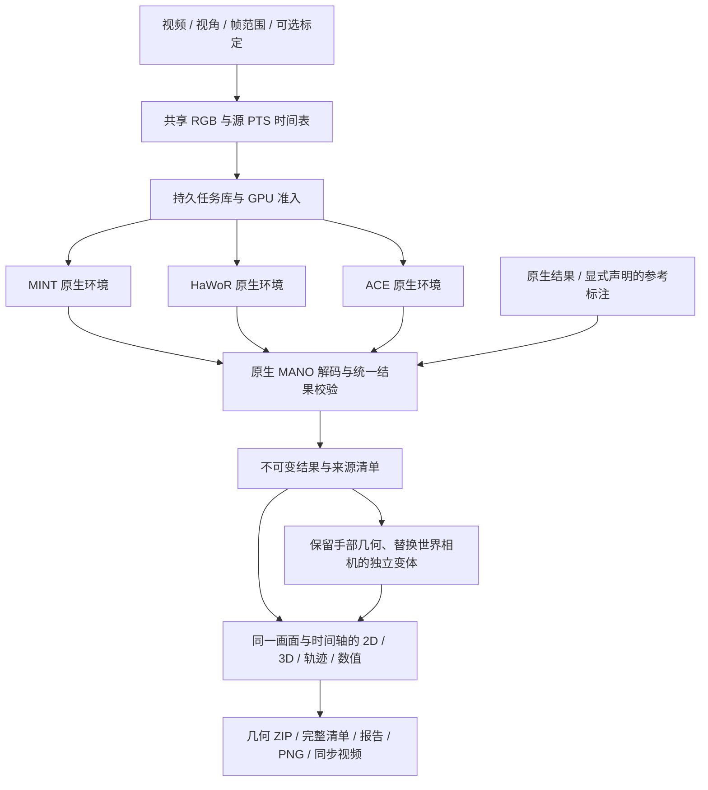

# MINT、HaWoR、ACE 统一推理与比较平台

新入口为 `/compare`，原单算法工作台保留在 `/`。同一个视频只建立一份解码后的 RGB、源帧号与 PTS 时间表；每套算法在自己的 Python/CUDA 环境里运行，通过经过校验的数值文件交换结果。平台没有合并三套权重，也没有更改原生网络或训练过程。



## 运行变体

| 变体 | 输出与输入要求 | 序列行为 |
|---|---|---|
| MINT | 双手 MANO、相机、存在性；默认使用生产平滑参数 | 保留原有窗口推理、拼接和共享 GPU 调度；无默认总帧数截断 |
| HaWoR Full | 检测、跟踪、相机系手部、DROID-SLAM、Metric3D 尺度、世界补全 | 保留全部选中帧；世界阶段失败时发布明确标记的相机系部分结果 |
| HaWoR Camera only | 检测、跟踪、相机系 MANO | 不运行世界阶段；不会填造相机轨迹 |
| ACE K-free | 模型预测内参、相机系 MANO、2D/3D 存在性 | 默认独立 81 帧 VAE 片段，首尾锚定、覆盖全部帧，明确区别于整段 VAE |
| ACE K-given | 与 K-free 独立的模型；需要显式针孔标定 | 同上，记录外部标定来源 |
| Reference | 仅导入标准几何，声明来源、坐标、米制单位及帧映射 | 不执行模型；声明不代表平台验证过标注质量 |

ACE 的 `native_tiled` 模式保留原生整段 VAE 与 `4k+1` 长度规则。例如输入 118 帧时输出 117 帧，任务标记为 `partial`，最后一帧显示缺失。默认 `independent81` 模式通过原生片段合并扩展处理长序列，不把它标成原生整段结果。短于 81 帧时应显式选择原生模式，平台不会补帧。

HaWoR 默认工作宽度 832，可显式设为 0 使用原尺寸。MINT 适配层按原生独立 16 帧分组分发手部任务，保留最后一组重复末帧的规则；检测跟踪和 SLAM 保持顺序。掩码采用与原生渲染 alpha 等价的批量光栅化，并以布尔值合并，避免完整序列的 float64 掩码中间量。SLAM 缓冲及因子图状态按实际关键帧数扩容，显存不足时明确保留部分结果。所有选中帧均保留，网络、MANO、SLAM、尺度及补全仍调用外部项目的原生实现。

默认原生后端最多使用 8 张 GPU。ACE 独立片段、HaWoR 手部与 Metric3D 关键帧可以多卡分发；原生整段 ACE VAE、HaWoR 连续检测和 SLAM 等阶段仍有顺序依赖。页面显示每阶段的实际卡数与并发峰值，上限不表示每个阶段都会同时使用 8 张卡。

## 页面使用

1. 输入服务器视频路径，选择完整画面或双目左/右眼。目标 FPS 为 0、最多帧数留空时处理全片。起始帧按原视频帧号解释。
2. 勾选算法，在“运行参数”中选择片段策略、工作尺寸、平滑及资源策略。K-given 必须填写相机 JSON；K 对应原始完整视频网格，包含 `K`、`width`、`height`、`source`。双目右眼标定的主点也必须以该完整网格表达。
   每种原生算法都可设置 1–8 张 GPU 上限；实际卡数随可用显存、其他任务、协作租约及当前可并行任务数变化。
3. 提交后可离开页面。历史任务保存在 SQLite 中。每个算法可以独立查看阶段、日志、取消与恢复；相同输入、代码、权重和参数的任务复用同一 run。
4. 时间轴、逐帧按钮和速度控制同时驱动各列。各列从一个解码画面复制背景，避免多个播放器各自漂移。2D 使用每个算法自己的 K；3D 可以切换相机系、世界系，拖动旋转、滚轮缩放，使用共同米制比例。
5. 世界比较使用首个共同有效相机帧重置坐标，保留算法间尺度差。如果没有共同有效相机帧，页面明确显示不可比较；ACE 自身没有世界相机。
6. 在“相机来源组合实验”中选择手部 run 和世界相机 run。生成独立结果，手部相机系几何和 K 保持原值，只替换外参来源。可用 ACE + MINT camera、ACE + HaWoR camera 等方式比较组件影响。
7. 几何 ZIP 包含完整逐帧 NPY 与来源清单；比较报告保存元数据和数值，PNG 保存当前 2D/3D 视图，同步视频在后台按全部样本帧生成。视频中的存在性显示选项继承导出时的勾选状态。

只为轨迹显示进行最多 1500 点的抽稀；存储的数值、数值指标与导出视频不受该显示抽稀影响。视频代理与同步导出使用恒定播放帧率，每个播放帧对应一个选中源帧；精确源时间使用清单中的 PTS，尤其是可变帧率输入。

## 结果协议与比较边界

每个 run 的 `result/result.json` 最后原子发布，记录代码内容摘要、原生环境版本、权重及输入文件身份、参数、时间与各数组身份。主要数值为：

| 字段 | 形状 | 语义 |
|---|---|---|
| `joints_camera_m` | T × 2 × 21 × 3 | OpenPose21，左/右固定顺序，光学相机系，米 |
| `vertices_camera_m` | T × 2 × 778 × 3 | 使用各算法原生 MANO 解码得到的顶点 |
| `geometry_valid` | T × 2 | 有限几何；缺失手的点必须为 NaN |
| `source_frame_indices` / `timestamps_s` | T | 原视频帧号 / 原视频 PTS 秒 |
| `K` | T × 3 × 3 | 原始选中画面的零斜切针孔投影矩阵 |
| `T_world_camera` / `pose_valid` | T × 4 × 4 / T | 可选的真实相机外参及有效性；不使用单位阵替代缺失相机 |
| `presence` / `confidence` | T × 2 | 可选的存在性判断 / 原生概率，保留其算法语义 |
| `tracked` / `filled` | T × 2 | 可选的跟踪 / 世界补全标记，不能当作检测置信度 |

腕点取解码后的 MANO/OpenPose21 第 0 点。MANO 参数中的平移通常不等于腕点；平台不把二者直接混用。ACE 的直接预测关节与 MANO 解码关节也不同，本工作台的统一几何采用 MANO 解码结果，原生直接预测保留在阶段文件中。

没有声明 GT 时，数值仅表示算法之间的差异。指标包括相机系关节/腕差异、腕对齐和逐手逐帧 Sim3 对齐差异、各自 K 下的重投影差异、腕速度差异、覆盖与缺失，以及世界相机的首帧对齐差异、SE3/Sim3 ATE 和共同有效时间间隔的 RPE。原始尺度误差与拟合尺度结果分别保存。均值使用共同有效几何，不用存在性阈值暗中删去困难预测。它们不是未经验证的精度排名。

## 原生导入与复用

展开“导入已有算法结果”，沿用上方输入设置并给出文件、格式、来源说明与样本相对位置 `frame_map`。支持 MINT NPZ、HaWoR 世界 NPZ、ACE PKL、标准几何 NPZ。HaWoR 还必须提供原生图像网格 `[width,height]`。ACE Pickle 只允许配置的 ACE `results` 目录内受信任文件。其余 NumPy 文件禁止 object/pickle 数组。

旧结果往往没有输入身份，帧对应和来源需要导入者明确声明，平台不能从旧文件自动证明原始 RGB 和标定完全一致。导入记录会保留该边界，耗时仅包含导入/解码，不冒充原始推理速度。

“加入已有结果或 GT”只列出样本身份相同的 run，可把不同时间运行的模型、导入结果和参考标注加入同一次比较。正在查看相同样本时，新导入结果也会自动追加。

## 资源、恢复与部署

默认部署依赖三个现有目录，不把依赖和模型复制进本仓库：

```text
/data1/lizhen_algo/mint/.venv/bin/python
/data1/lizhen_algo/hawor/.venv/bin/python
/data1/lizhen_algo/ace_ego_hand/.venv/bin/python
```

可用 `MINT_COMPARISON_MINT_ROOT`、`MINT_COMPARISON_HAWOR_ROOT`、`MINT_COMPARISON_ACE_ROOT` 改变根目录。后两者原项目及用户工作区修改均保留。新模块在 `mint/comparison/`，Viewer 只挂载 blueprint 和入口链接。

| 设置 | 默认 | 用途 |
|---|---|---|
| `MINT_COMPARISON_DIR` | 项目 `.cache/comparison` | 输入、SQLite、run 与导出 |
| `MINT_COMPARISON_MAX_ACTIVE` | 3 | 同时准备/运行的算法任务数 |
| `MINT_COMPARISON_MAX_IMPORTS` | 2 | 独立 CPU 导入并发；不会被等待 GPU 的任务阻塞 |
| MINT `max_gpus` | 8 | 原有动态多 GPU 调度上限；外部原生 worker 每个使用一张卡 |
| `MINT_COMPARISON_INPUT_MAX_GIB` | 256 | 共享 RGB LRU 预算，活跃读取受 pin 保护 |
| `MINT_COMPARISON_PROXY_MAX_GIB` | 16 | 共享播放代理的持久配额；不会为腾空间删掉已有任务的输入播放文件 |
| `MINT_COMPARISON_RUN_MAX_GIB` | 256 | 原生阶段和完整数值的准入配额；不自动删除已完成数值 |
| `MINT_COMPARISON_EXPORT_MAX_GIB` | 16 | 同步 MP4 LRU 配额，最多同时编码一个 |
| `MINT_COMPARISON_ZIP_MAX_GIB` | 16 | 磁盘 ZIP LRU 配额，避免把整片顶点放进内存 ZIP |
| `MINT_CACHE_MIN_FREE_GIB` | 16 | 磁盘余量保护 |
| `MINT_COMPARISON_JOB_TIMEOUT_SECONDS` | 86400 | 单个原生 worker 的最长运行时间 |
| `MINT_COMPARISON_DECODE_WORKERS` | 4 | 独立视频解码器数量，范围 1–8；写入互不重叠的全分辨率 RGB 区间 |
| `MINT_NATIVE_RAM_RESERVE_GIB` | 64 | 原生多卡模型加载时保留的主机内存；模型副本另有跨进程准入预留 |

共享输入解码与预览编码重叠运行，预览直接读取已完成的 RGB 区间，避免再次解码原视频。预览宽度最多 1280，页面按显示网格缩放投影；模型输入仍为全部选中源帧的原始分辨率 RGB。完成的完整缓存才会发布。

所有增强代码、原生调用适配、缓存和输出均在 MINT 目录。`/data1/lizhen_algo/ace_ego_hand/` 与 `/data1/lizhen_algo/hawor/` 作为只读依赖，原生 worker 设置独立缓存路径并拦截对这些目录的 Python 写入，不修改它们的源码、模型或虚拟环境。GPU 子进程在各自环境内持久加载模型，阶段结束后释放 GPU；共享暂停期间保留模型以避免重复冷加载，显存或外部负载压力仍可触发释放。

Shared 默认允许在有足够显存余量且负载较低的卡上适度共享，使用显存上限，并在原生阶段/片段之间主动让出时间。它没有硬件级计算隔离保证。Idle 等待没有其他计算进程的卡；Dedicated 也要求启动时为空卡并持有协作租约，不能阻止非协作程序后来进入该 GPU。所有后端与旧 MINT 共用物理 GPU UUID 租约，最多覆盖服务器可见的 8 张卡，不终止其他任务。

持久队列中的未启动任务在服务重启后保留。已启动 worker 绑定父进程退出信号，按 PID、启动时间和私有 session 回收自己的子进程；中断任务可手动恢复。MINT 复用原有窗口缓存；ACE 复用完整片段；HaWoR 仅复用经过完成清单与文件身份校验的输入、检测、运动和 SLAM 阶段。源视频、代码或权重变化会产生新的任务身份，不把旧阶段混入新算法结果。

服务仍只绑定服务器 `127.0.0.1:8011`，通过现有 SSH 隧道访问 Mac 的 `http://127.0.0.1:18011/compare`。候选验收使用独立 8024 / 18014 端口，验收后才更新正式服务。

## 主要 API

| 方法与路径 | 功能 |
|---|---|
| `GET /api/algorithms` | 依赖就绪情况与能力 |
| `POST /api/comparisons` | 输入协议 + selections 创建持久比较 |
| `GET /api/comparisons`、`GET /api/comparisons/{id}` | 历史与当前比较 |
| `POST /api/comparison/import` | 显式原生/标准结果导入 |
| `POST /api/comparisons/{id}/attach`、`/combine` | 加入同样本 run / 生成相机组合 |
| `POST /api/comparison/runs/{id}/cancel`、`/resume` | 独立取消 / 恢复 |
| `GET /api/comparison/runs/{id}/frames?start=0&count=64` | 按样本位置同步读帧，缺失不重复末帧 |
| `GET /api/comparison/runs/{id}/trajectory` | 供显示使用的轨迹 |
| `GET /api/comparisons/{id}/metrics` | 带范围、覆盖和对齐说明的数值 |
| `GET /api/comparison/runs/{id}/manifest`、`/download` | 完整来源 / 几何 ZIP |
| `POST /api/comparisons/{id}/export` | 异步生成同步视频，支持 `include_absent` |
| `GET /api/comparison/exports/{id}`、`/{id}/download` | 导出进度 / 下载 |

验收记录见 [统一平台验收记录](comparison-validation.md) 与 [多卡及完整长视频验证](comparison-performance-validation.md)。
