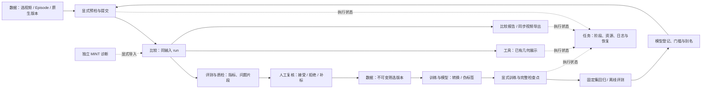

# 模块功能与流程地图

本页按当前仓库中的页面、路由和服务实现说明功能，不以“有按钮”推断后端或
模型资产已就绪，也不把功能存在等同于质量、性能或跨机验收通过。架构分层与
原研究 / 许可边界见 [architecture.md](architecture.md)。

## 入口与六个主模块

打开 `/` 默认跳转到 `/compare`。顶部共有六个主模块，MINT 单算法诊断另有
独立地址。下表 URL 是同一工作台的导航状态，不是独立部署的多个服务。

| 一级模块 | 入口 / 可直达视图 | 主要职责 |
| --- | --- | --- |
| 数据 | `/compare?hub=data`；`hub=catalog`；`hub=batch` | 选择输入、接入原生数据、整理待提交清单、检索产物、批量比较 |
| 比较 | `/compare`；`/compare?id=<comparison_id>` | 保存同输入对照关系，同步看预测 / GT，查看指标、组合与导出 |
| 评测与质检 | `/compare?hub=evaluation`；`hub=quality` | 数据集评测、逐帧线索、差异分解、区间复核和二维修正 |
| 训练与模型 | `/compare?hub=research`；`research_tab=train/curves/regression/protocol/production/models` | 数据转换、生产、训练、检查点、固定协议、回归、模型版本与发布门槛 |
| 任务 | `/compare?hub=tasks` | 统一查询执行状态、阶段、等待原因、资源、日志及可用的取消 / 恢复入口 |
| 工具 | `/compare?hub=tools`；`tools_tab=catalog/render/environment` | 工具目录、从已有几何生成展示视频、按需检查环境 |
| 独立 MINT 单算法诊断 | `/diagnostics` | MINT 配置、推理、结果 / 损失与专项研究工具；独立保存当前配置 |

`id`、`workflow`、`study`、`collection`、`section` 等参数用于定位保存记录或
视图。旧 `/?tool=…`、`/?task=…`、`/?view=…` 仍跳转到诊断页并保留参数。
切换模块可保留表单、滚动位置与已有选择；进入页面或定位栏目不会提交计算。
顶部“功能流程”可打开闭环说明弹窗，并直接进入现有模块与训练子视图。
弹窗是导航帮助，不是第七个主模块，也不是自动执行的工作流。

## 先理解输入、比较、run 与任务

| 记录 | 保存什么 | 与其他记录的关系 |
| --- | --- | --- |
| 输入 / sample | 源文件身份、视角、帧范围、目标 FPS、显式标定、准备后的帧时间线 | 同一输入协议才可放在同一比较；同一文件但不同视角 / 范围 / 标定仍可能是不同 sample |
| 比较 / comparison | 标题、sample、被引用的 run 与复用说明 | 是对照容器；可包含多个算法、导入参考与派生组合，也可引用其他比较已用过的 run |
| run | 某个算法与选项、模型 / 配置身份，或一次导入 / 相机组合的结果身份 | 原生 run 对应实际推理；导入只解码已有数值；组合从已有几何产生新结果 |
| 任务 / task | 推理、批次、评测、训练、导出、展示等执行的状态、尝试、阶段与事件 | 是统一观察口径；一个比较可能有多个任务，一个批次可建立多组比较 |

因此，“新建比较”不保证每个算法都重新运行：相同身份或兼容结果可被复用；
“打开比较”只是读取记录；“任务完成”也不必然等于所有几何或世界相机可用。
应同时查看 run 状态、有效帧、来源、协议及输出能力。

## 1. 数据

数据模块包含“数据接入、数据与结果目录、批量比较”三个二级工作区。

| 功能 | 输入 | 用户动作 | 产物 | 可衔接的下一步 | 不会自动执行 |
| --- | --- | --- | --- | --- | --- |
| 服务器视频 | 可读视频目录 / 绝对路径、视角与帧协议 | 浏览或扫描目录，选视频；可累积多个目录的勾选 | 当前输入草稿、批量待提交清单 | 新建比较；批量统一设置 | 浏览 / 勾选不启动推理；扫描不证明画面或标注质量 |
| LeRobot Episode | 数据根目录、相机流、Episode | 读取元数据、分页选择；分别选择附加 GT 与使用标定 | 保留 Episode、相机与偏移的输入上下文 | 单次比较；批量比较；有 GT 时评测 | 不把 GT 自动作为算法输入；切换相机不沿用不匹配的 Episode 元数据 |
| 开源数据原生接入 | 本地 EgoDex、DexYCB、ARCTIC 目录，官方划分与序列 | 查看目录 / 格式清单，选序列、范围与训练格式，预检并准备数据版本 | MINT 自有视频、标准参考、来源与帧映射；适配器允许时生成训练格式 | 用准备版本做同输入比较；训练就绪版本转训练 | 不下载未提供数据，不改原始数据；目录“可用”不是完整内容认证 |
| 数据与结果目录 | 已发布几何、保存预测、协议、复核、数据 / 模型等记录 | 搜索、分页、看来源详情；显式导入离线预测；选择已接受复核记录发布版本 | 可追溯记录、导入后的比较、不可变复核筛选清单 | 打开结果；转换筛选清单；使用模型建立比较 | 登记文件不运行网络；复核清单尚不是训练就绪数据 |
| 批量比较 | 多视频 / Episode 清单、统一算法和帧协议、GT / 标定策略、资源策略 | 核对清单 → 统一设置 → 逐输入预检 → 明确提交 | 批次及每个输入独立的比较、run、报告 | 逐项打开比较、查看任务、下载报告、质检 | 修改待提交清单不改变已提交批次；批次不是一个拼接视频或一条共享 GT |

原生接入支持不代表所有数据集具有同等监督：当前目录适配器为 EgoDex、
DexYCB、ARCTIC；训练格式导出能力由适配器与实际资产决定。官方 train / val /
test 来源保留，验证 / 测试来源不能通过复核导出偷换成训练分区。

目录中的“下一步”依产物能力显示：原生样本可“用此样本配置比较”；
`training_ready` 数据可“用此版本配置训练”；`reviewed_manifest` 可“配置复核
数据导出”；固定协议可配置离线评测或固定集回归；原生离线报告可配置模型
发布。这些入口只预填 / 定位，不自动预检、提交或运行。刚发布的复核清单也
提供导出配置按钮，明确选择 `curate_dataset`；导出完成才产生新的训练格式版本。
模型伪标签进入训练配置时仍需重新明确允许，不会由快捷入口自动勾选。
原生样本入口返回数据模块的公开数据第 3 步，选中已准备版本后再配置算法；
协议只含单一 validation / test 划分时会预填对应划分；评测报告只预选报告，
发布所需的匹配模型仍须另选。

关键实现：`web/source-browser.js`、`web/platform.js`、`datasets.py`、
`native_sources.py`、`collections.py`、`research.py`。相关接口包括
`/api/comparison/dataset`、`/native/catalog`、`/native/sequences`、`/scan`、
`/collections/preflight`、`/collections`（后几个路径均以 `/api/comparison` 为前缀）。

## 2. 比较

比较以“同输入、不同结果”为核心，历史记录按源、Episode、相机与视角分组。
默认是固定一个基准和切换一个候选，也可选择总览。

| 功能 | 输入 | 用户动作 | 产物 | 下一步 | 不会自动执行 |
| --- | --- | --- | --- | --- | --- |
| 新建算法比较 | 视频 / Episode、帧协议、显式标定、算法、模型与资源策略 | 配置并查看协议概览，预检，开始比较 | comparison、run 请求、实际执行任务或复用引用 | 同步查看、任务详情、指标 | 打开配置窗口与预检不启动模型推理 |
| 导入已有数值 / GT | 原生或标准数值文件、明确帧映射、来源 / 坐标 / 单位声明 | 选择算法与格式，显式导入并解码 | 标准几何 run；reference 输入带声明 GT 角色 | 与同一 sample 的预测对照、离线评测 | 导入耗时不包含原推理耗时；不自动认证 GT 质量 |
| 联动 2D / 3D | 已发布 run 的关节 / 网格 / 相机与输入预览 | 播放、逐帧、跳帧，选基准 / 候选、坐标 / 几何、放大 | 当前查看状态、截图 | 查看当前指标、定位质检 | 显示选项不改变预测；缺世界相机不补造世界运动 |
| 指标与来源 | 当前选择的结果对与有效帧 | 打开指标、协议、逐帧诊断、运行详情 | 同输入配对差异、覆盖及来源解释 | 质检、报告、冻结协议 | 固定画面基准不把普通算法变 GT；无 GT 差异不等于准确率 |
| 已有结果管理 | 相同 sample 的已发布结果 | 显式附加；选择手部与相机来源组合 | 增加 run 引用，或带组件来源的新组合结果 | 对照组合、下载数值、工具展示 | 不重新运行核心网络；组合不覆盖原结果，不冒充原生世界预测 |
| 报告与同步视频 | 选定可见结果、范围和显示设置 | 显式截图、下载或提交同步视频导出 | 报告 / 数值 / 清单、视频及导出任务 | 分享、核查、任务中心 | 切换候选不重跑算法；导出不修改原数值 |

可选原生后端是 MINT、HaWoR Full、HaWoR Camera only、ACE K-free、ACE K-given，
另有只导入的 Reference。实际可运行性以选定后端预检为准。HaWoR Camera only
不运行 SLAM / 世界补全；ACE K-given 需要显式针孔标定，不能和 K-free 的输入
信息混为同一协议。Full 的相机系部分结果与完整世界结果也要分别识别。

关键实现：`api.py`、`jobs.py`、`registry.py`、`preflight.py`、`contracts.py`、
`normalizers.py`、`results.py`、`exports.py` 及 `web/app.js`、`workspace.js`、
`result-tools.js`、`geometry-tools.js`。主要入口为 `POST /api/comparisons`、
`/api/comparison/preflight`、`/import`、`/api/comparisons/<id>/attach`、
`/combine`、`/metrics`、`/export`。

## 3. 评测与质检

模块包含“数据集评测”和“逐帧质检”，并能回到所选比较的指标。检查点回归 /
性能入口连接“训练与模型”，公开基准入口连接 MINT 诊断工具。

| 功能 | 输入 | 用户动作 | 产物 | 下一步 | 不会自动执行 |
| --- | --- | --- | --- | --- | --- |
| 数据集评测 | 每项有可用声明 GT 的输入、算法、帧 / 标定协议 | 选择样本 → 选择算法 → 预检并提交 | 持久评测批次、各输入比较、聚合报告与覆盖信息 | 打开失败 / 高差异样本、导出报告、逐帧质检 | 无 GT 视频不能冒充有 GT 评测；GT 不自动喂给算法 |
| 逐帧质检 | 一组已发布比较中的预测，可选声明 GT 或另一算法 | 选择结果 / 阈值，显式“查找问题片段” | 逐帧曲线、缺失 / 存在性 / 运动线索和候选片段 | 跳转原帧、差异分解、区间复核 | 无参考线索不等于误差；问题候选不自动判为坏样本 |
| 差异分解 | 同输入预测与选定参考 / 算法对照 | 显式分析并选择明细 | 手、关节、相机等可用差异明细与下载 | 针对片段复核 | 不增加结果原本没有的 GT 或相机能力 |
| 区间人工复核 | 已生成质检记录、包含端点的样本帧区间、审阅人 | 接受 / 拒绝 / 需要补标，保存备注 | 不可变 review 记录 | 数据目录勾选已接受记录，发布筛选版本 | “接受”只表示筛选决定，不把预测升级为真实标注 |
| 二维点修正 | 源图像、预测投影、左右手 / 可见性、当前父版本 | 读帧、编辑像素点、保存新修订，可查看历史 | 带源与结果身份、父版本的 annotation | 后续人工检查；保留修订链 | 不回写原几何；不生成三维 / MANO GT；当前不作为训练监督 |

二维修正以原图网格保存 `[2,21,2]` 像素点与 `[2,21]` 可见性。服务核对视频、
结果身份和父版本，冲突时要求重新读取。本机未提交草稿与服务器修订分开；
“接口验收”目的另有标签，不能冒充正式人工标注。

关键实现：`collections.py`、`evaluation.py`、`quality.py`、`diagnostics.py`、
`annotations.py`、`research.py` 和 `web/research.js`。接口为
`/api/comparison/quality`、`/runs/<id>/breakdown`、`/runs/<id>/annotation-context`、
`/annotations`、`/annotations/history`，以及 `registry/review`。

## 4. 训练与模型

训练与模型有六个内部视图：训练任务、曲线与检查点、回归与性能、固定协议与
评测、伪标签生产、模型与发布；它们仍属于一个一级模块。

| 功能 | 输入 | 用户动作 | 产物 | 下一步 | 不会自动执行 |
| --- | --- | --- | --- | --- | --- |
| 转换已有相机标注 | LeRobot 根目录、明确 Episode 与范围 | 预检并提交转换 | 有来源 / 视频偏移的不可变相机训练数据版本 | 选择训练配置并训练 | 不补造 MANO 标签；不能通过再次转换洗掉原有伪标签角色 |
| 导出复核相机伪标签 | 已接受复核筛选版本、有效世界相机与适用针孔内参 | 预检并显式导出 | 标记模型生成来源的相机监督版本 | 显式允许伪标签后训练 | 人工复核不变成真值；只提供相机监督，不生成真实手部标签 |
| 原生 MINT 伪标签生产 | 完成的原生 MINT camera + MANO 结果，原始数值与视频 | 选 run、划分和运动筛选阈值，预检并提交生产 | 相机 / MANO 伪标签、掩码、帧映射、来源清单和数据版本 | 核查版本，再显式允许伪标签训练 | 不接受只有可视化的结果或冒充原生的导入；不等于参考重建链 |
| 参考研究链（高级） | 显式视频路径、GeoCalib / MoGe / Mega-SAM / HaWoR 资产与独立依赖 | 预检完整条件后提交 | 条件满足时由研究管线处理的数据产物 | 核查监督与格式后另行选择训练 | 缺依赖时阻止提交；不因页面存在就声称生产已验收 |
| 训练 / 严格续训 | 就绪数据、训练配置、初始化权重或完整恢复目录、固定 GPU 数 | 预检；显式启动或恢复；按需取消 | 有效配置、日志、曲线、完整检查点与工作流记录 | 完整检查点转回归 / 模型登记 | 不自动使用伪标签；不自动修改推理环境；训练启动不保证质量提升 |
| 曲线与检查点 | 已提交训练 workflow | 选择任务，查看步骤指标与完整性；填入候选 / 登记表 | 曲线、尝试记录、可用检查点选择 | 固定集回归、模型登记 | 填入下一步表单不执行回归，不自动发布模型 |
| 固定协议与离线评测 | 同输入比较、唯一声明 GT、明确 train / validation / test；已有 run | 冻结协议；选择 validation / test 与预测，显式评测 | protocol、数值评测报告、失败与覆盖信息 | 模型门槛、回归候选对照 | 离线评测不启动缺失推理，不给已有结果补测冷启动时间 |
| 固定集回归 / 资源性能试验 | 冻结协议或已有比较，原生候选，资源上限 / 重复设置 | 显式提交试验 | 新原生子运行、数值与耗时 / 资源记录 | 评估候选、保留实验记录 | 不自动启用加速 / 融合；GPU 上限不代表实际卡数或线性提速 |
| 模型登记、门槛与别名 | 现有检查点、配置、匹配原生离线报告和阈值 | 登记 → 选择报告 → 通过门槛更新别名；按需回滚 | model 记录、alias 与门槛事件 | 在后续 MINT 比较中明确选择该检查点 | 登记不等于发布；alias 不热替换默认权重或已运行模型 |

训练要求监督与实际数据匹配：`require_mano_gt` 需要实际 MANO 参数，预测 MANO
只能按伪标签规则使用；`allow_pseudo_labels` 是明确授权。camera-only 数据仍是
camera-only，二维点修正的 `training_eligible=False` 不因接受复核而改变。
原生生产读取所选比较中完整的原生 MINT 结果，不自动套用质检区间或二维
修订。需要按已接受复核片段导出时，应走“复核筛选清单 → 复核相机伪标签
导出”路径，不能把两个生产入口理解为同一操作。

冻结协议阻止同一来源 / Episode 跨分区；原生数据保留官方划分。离线评分按
有效样本汇总，同时把缺失与失败预测纳入覆盖分母。发布还检查权重与推理配置
身份、原生评测来源、完整结果、误差 / 覆盖阈值及已声明训练数据的测试重叠；
它不能证明未登记数据不存在泄漏，也不能替代独立质量验收。

训练在 MINT 自有独立环境运行。`init_from` 是用权重开始新实验，
`resume_checkpoint` 是恢复模型、优化器、调度器、RNG 与步数；严格恢复要求
完整检查点及相同 world size。正式配方为 `mint_step1.yaml`、`mint_step2.yaml`；
camera smoke 配方只验证执行链路，不能据此宣称训练效果改善。

关键实现：`workflows.py`、`workflow_worker.py`、`training_data.py`、
`production.py`、`training_curves.py`、`research.py`、`studies.py`、`model_train/`，
以及 `web/research.js`、`enhancements.js`。主接口为
`/api/comparison/workflows/preflight`、`/workflows`、`/studies`、`/registry/<kind>`、
`/models/promote`、`/models/rollback`、`/models/aliases`。

别名发布 / 回滚成功后，可点击“用别名 … 配置新比较”：页面读取当前仍可用的
已评测别名，把权重与匹配的推理配置填入 MINT 比较草稿，再由用户核对输入、
预检与提交。它不会立即推理，也不让原运行切换模型。目录跳转、导出配置和
发布后配置都核对当前选择，迟到回包不得覆盖用户后来选择的对象或视图。

固定集回归恢复按冻结算法选择找回候选预测，GT 仍作为冻结参考留在比较历史，
不会加入预测评分列表；失败或尚无数值输出的候选仍保留失败 / 覆盖口径。
恢复已有子比较不因重新读取 GT 而重复创建推理。

## 5. 任务

**入口：** `/compare?hub=tasks`。输入是各执行器已经提交的工作，不要求先选中
一个比较。可按名称 / 来源搜索，按状态与任务类别筛选、分页查看。

**动作与产物：** 打开任务可查看父级比较、执行尝试、当前阶段、等待原因、
阶段耗时、可用的阶段 ETA、日志和资源信息；按任务类型返回比较 / 批次 /
训练 / 展示，执行明确的取消或恢复操作。产物是持续任务索引和阶段事件，
实际数值 / 视频 / 模型仍由各源执行器保存。

**下一步与边界：** 失败、部分完成或中断时先核对来源、错误与缓存，再使用该
类型提供的恢复 / 重新提交入口。恢复不是统一的“继续上一帧”：推理复用完整
阶段，训练用完整状态，展示视频按原参数重新生成；持久同步视频导出重放时从
帧零开始。取消的导出不因重启自动跑。任务索引不因心跳陈旧直接判失败，不
终止外部用户进程；阶段 ETA 不是全流程 ETA。批次取消保护其他比较共享的 run。

资源区把物理 GPU、允许上限、可调度与实际运行数量分开，并展示 CPU / RAM /
磁盘等观察数据。协作式 GPU 租约不构成硬件隔离，等待空闲不意味着可以抢占
其他用户。跨阶段、并行进程时间不能直接求和作为端到端耗时。

关键实现：`workspace.py`、`task_index.py`、`observability.py`、
`web/platform.js`；入口为 `/api/comparison/workspace`、`/tasks/<kind>/<id>`
及各执行器的取消 / 恢复接口。`platform_tasks` / `platform_events` 是后台索引，
不是独立页面或另一套执行引擎。

## 6. 工具

工具有“工具目录、生成展示视频、环境检查”三个视图，各自选择输入。

| 功能 | 输入 | 动作与产物 | 下一步与不自动执行边界 |
| --- | --- | --- | --- |
| 视频基础属性 | 服务器视频 | 进入诊断工具，按需读取媒体分辨率、帧率、时长等 | 可返回选择输入；不检测模糊、遮挡或语义画质 |
| 相机内参 / FoV | 工具选择的视频 / 数据集与可用内参 | 查看相关参数与分析 | 用于检查参数；预测内参不成为独立标定真值 |
| 数据集多样性 | 工具选择的数据集合 | 按需分析数据分布与轨迹差异 | 了解覆盖情况；不自动认证数据质量 |
| MINT / 公开基准 / 代码差异 | 各专项工具所需输入、检查点与协议 | 进入独立诊断工具，明确提交相应分析 | 各有来源与结果；不把当前比较自动当成官方 Benchmark |
| MuJoCo 三维展示 | 已有结果的 MANO 顶点、坐标与片段 | 显式提交展示任务，下载视频及帧映射 | 不运行手部推理；不覆盖几何；环境可用不等于结果正确 |
| Wuji Hand 重定向 | 已有手部几何、坐标与片段 | 显式提交运动学映射展示 | 不代表接触、碰撞、抓取稳定性或动力学已验证 |
| 环境检查 | 选择推理 / 数据 / 训练 / 展示等检查项 | 读取能力、依赖与资产缺项 | 补齐条件后重新预检；不安装依赖、不启动训练或申请云资源 |

世界坐标展示要求所选范围有实际有效世界相机；相机坐标展示不产生世界轨迹。
范围还要覆盖结果实际输出帧。修改草稿、切换当前比较不会改变已提交展示任务
的来源和设置。失败 / 取消 / 中断 / 缓存释放后的“按原参数重新生成”会重新
执行展示，并非从旧视频中间帧继续。

关键实现：`tools.py`、`tool_worker.py`、`web/platform.js` 与诊断 routes；
接口为 `/api/comparison/capabilities`、`/diagnostics`、`/runs/<id>/tools/options`、
`/runs/<id>/tools`、`/tools/<job_id>`。

## 独立 MINT 单算法诊断

**入口：** `/diagnostics`，顶部常驻链接与工具目录均可进入。页面有“配置与运行、
结果与损失、专项工具”三个视图；它不是第七个主工作台模块。

- **输入：** 视频或 LeRobot Episode、MINT 检查点、窗口 / 平滑策略与研究参数；
  GT 可在具备标注时读取。诊断表单与多算法比较表单独立。
- **动作：** 明确加载 / 运行 MINT、查看预测和可用损失、逐帧几何 / 数值 / 相机 /
  手形诊断，进入批量推理、公开基准、数据分析或代码差异等专项工具。
- **产物：** 诊断当前结果、保存预测、缓存与专项任务记录；可用结果的含义受
  当前模型、标注、输入和工具能力限制。无 GT 时不能凭损失视图声称准确率。
- **下一步：** 在主工作台显式“将已有结果加入比较”或导入保存的 NPZ，核对
  输入和帧映射后进入统一对照；导入不重复网络推理。
- **不自动执行：** 切换视图 / 栏目不推理，不运行 MuJoCo 或重定向；修改配置
  不改变已提交任务。运行期间输入与模型受锁定，防止错配。

实现位于 `eval/model_effect/visualization/viewer/`（诊断路由、Store 与 web），
推理复用 `mint/inference/`；`mint/comparison/workspace.py` 提供明确的结果桥接。
原 Viewer 能浏览服务器绝对目录，仍须按受信任研究工具部署，使用 SSH 转发
或鉴权反向代理；主工作台导航不改变这个访问边界。

## 常见完整路径

1. **先看一个视频：** 数据选输入 → 新建比较 → 预检 → 提交 → 比较看结果 →
   当前指标 / 逐帧质检 → 明确导出。可仅选 MINT，不要求运行所有后端。
2. **多输入比较：** 数据累积勾选 → 批量统一设置 → 逐项预检 → 提交批次 →
   查看报告与各输入比较。提交后的输入冻结，待提交清单另行管理。
3. **有 GT 的评测：** 选有 GT 样本 → 数据集评测 → 报告与覆盖 → 高差异片段
   人工复核；需要可复用发布证据时另冻结协议并做匹配模型的离线评测。
4. **训练迭代：** 确认监督角色与训练版本 → 显式训练 → 完整检查点 → 固定集
   回归 → 登记与门槛 → 后续比较选择别名。各步骤均保留自己的输入与版本。

源帧索引从 0 起；播放、人工复核和展示表单的样本帧从 1 起，结束样本帧包含
在区间内。抽帧后样本帧不等于源视频帧；最多帧数留空表示完整选定范围。
跨模块定位只负责把可追溯对象带到正确视图，不能替代预检、人工决定或提交。

固定协议按 `sample_id` 定义唯一输入，不能把同一输入的不同历史比较重复纳入；旧重复协议保持可读，新评测、回归提交及恢复会明确拒绝，不再静默缩减统计数量。异常恢复按冻结算法/版本/选项识别候选，声明 GT 和后来附加的结果不进入预测评分列表，失败候选仍计入覆盖分母。
