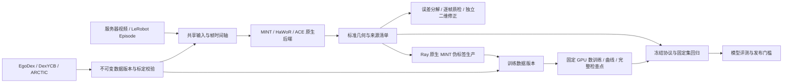

# 数据、回归、训练与生产工作流

入口是 `/compare`，继续共用已有的视频浏览、LeRobot Episode、任务中心、多算法展示和结果目录。



## 原生数据入口

在“数据与输入”读取 `/dataset` 清单，选择数据集、官方划分、任务分组和序列。帧数留空会准备完整序列；短验收可以显式选择帧范围。准备任务在后台执行，任务中心支持查看和恢复。

| 格式 | 已实现的监督 | 训练导出 | 帧与标定处理 |
|---|---|---|---|
| EgoDex | ARKit 相机轨迹、双手 21 点及置信度 | 相机监督；没有真实 MANO 参数 | part1–5 为 Train、test 为 Test；保存原帧号；全片直接复制 MP4，子片使用无损 RGB 编码 |
| DexYCB | 官方相机系 21 点，读取实际左右手元数据 | 本适配器只提供关节参考，不导出世界轨迹 / MANO 训练数据 | s1：subject 08/09 Test、07 Validation，其余 Train；无效标注帧保留在时间轴上；选择区间必须连续 |
| ARCTIC | 实际 MANO 参数、相机轨迹、21 点和网格 | 官方 Train 的 MANO 与相机监督 | 读取 P1 划分与 `ioi_offset`；ego 视图的缩放内参与 dist8 同步处理，去畸变到居中虚拟针孔相机 |

ARCTIC 的去畸变保持相机坐标轴不变，同时改变图像与内参。不可用的标注会在列表中提示；不会为缺少标注的 Test 序列生成 GT。EgoDex 的 ARKit 骨架与合成 RGB 可能存在投影差异，应按跟踪参考解释。

格式与划分依据：[EgoDex 官方资料](https://github.com/apple/ml-egodex)、[DexYCB 官方划分实现](https://github.com/NVlabs/dex-ycb-toolkit/blob/master/dex_ycb_toolkit/dex_ycb.py)、[ARCTIC 数据说明](https://github.com/zc-alexfan/arctic/blob/master/docs/data/data_doc.md)及[裁剪脚本](https://github.com/zc-alexfan/arctic/blob/master/scripts_data/crop_images.py)。

数据版本记录来源文件身份与 SHA256、适配器版本、监督类型、官方划分、原始帧映射、图像网格和相机参数。版本完成标记最后写入；中断目录在恢复时保留备份。原始 `/dataset` 不会写入。默认原生数据与伪标签生产各有 128 GiB 准入限额，并保留底层磁盘余量；已发布数据不会被当作普通 LRU 缓存删除。

准备完成后选择版本、算法与参数，点击“创建同输入比较并附加参考标注”。是否将数据集标定作为算法输入需要明确选择；MINT 仍保留自身相机 / FoV 预测的原生数值路径。

## 回归与诊断

“数据与训练 → 自动回归 / 性能”可冻结多个比较 ID。每个输入需要恰好一份已发布参考；数据集划分与官方来源一致。相同原始序列不能通过切片或换转换版本混入不同划分。

选择协议、算法、检查点后提交固定集回归，后台创建幂等子比较并读取既有 GT。完整结果会复用，失败样本保留在覆盖率与失败计数中。取消只作用于本试验独占的子任务；协调器中断后显式恢复，已提交但尚未登记的子任务可按稳定 ID 找回。

“质检与复核”增加左右手、逐关节、深度区间和画面边界分析，分别报告绝对关节误差、腕对齐误差、重投影误差、腕深度误差和有效计数。几何覆盖与手存在性召回分开；只标注有效正手的数据无法支持精确率。画面边界分组由投影计算，不能解释为真实遮挡标签。

二维编辑器以当前视频视图的像素网格工作。可点击 / 拖动 21 点，也可精确输入坐标、修改可见性和交换左右手标签。保存需填写审阅人，采用父版本检查防止覆盖并发编辑，支持历史查看和 JSON 导出。修正版本独立于原始几何；二维修正不会自动变成三维或 MANO GT。接口验收记录可以标记为 `interface_test`。

## 训练与检查点

“数据与训练 → 训练任务”选择转换后的 Train 数据、配置、初始化权重、GPU 数和步数。相机配方沿用 `configs/training/mint_step2.yaml`；真实 MANO 微调配方为 `configs/experiments/mint_mano_finetune.yaml`。公开两个训练阶段配置保持原有位置。

每次训练取得安全空闲 GPU 的独立租约，固定 world size，支持 1–8 卡。训练曲线记录实际优化器步骤的 loss、学习率、耗时与显存峰值，本地 JSONL 在中断后修复不完整尾行，恢复的重复步以最新尝试显示。完整检查点包含模型、优化器、调度器、随机状态和训练游标；文件身份校验通过后才能作为完整检查点展示。

“曲线与检查点”可把某个完整检查点填入固定集回归候选。评测和别名发布继续使用原有门槛；短训通过不代表精度提升，也不会替换默认模型。

## Ray 原生后端生产

先通过比较 / 批量入口运行 MINT，再把完整原生 MINT Run ID 交给“伪标签生产”。该路线复用已验证推理后端，使用独立 `.environments/data` 的 Ray CPU 任务并行发布无损视频、相机、MANO、关节点与来源清单。异常运动、画面外与非正深度手只做监督掩码，保留完整时间轴和原始时间戳，不插值伪造标签。

产物明确标注 `model_generated_pseudo_labels`。官方验证 / 测试来源不能转入 Train；训练时需显式允许伪标签。可变帧率输入需要先明确目标 FPS，避免训练标签与恒定 FPS 视频错位。

安装该路线的最小独立环境：

```bash
.venv/bin/python scripts/setup_platform_environment.py --profile native-data
```

原 MegaSAM / MoGe / GeoCalib 参考重建链仍有单独的资产、编译依赖与环境检查；本次生产验收针对上述可执行的原生 MINT + Ray 路线。

## 性能与部署

性能试验串行运行 1 / 2 / 4 / 8 卡上限，记录实际 GPU 并发、阶段耗时、主机资源和几何 / 存在性 / 相机数值门槛。新原生进程会关闭推理缓存恢复，但共享图像和 OS 文件缓存可能已经预热；完整结果查询另列，不能当作冷启动速度。

真实 288 帧样本单次实测：

| GPU 上限 / 实际峰值并发 | 含排队总耗时 | 最大关节坐标差 |
|---|---:|---:|
| 1 / 1 | 33.4 s | 0 m |
| 2 / 2 | 24.4 s | 0 m |
| 4 / 4 | 21.3 s | 0 m |
| 8 / 8 | 22.7 s | 0 m |

该短样本用 4 卡略快，不能推断所有长度或算法都应使用同一卡数。

多机部署保留可执行启动器 `python -m mint.comparison.distributed`。部署清单使用连续 rank、相同每机 GPU 数和 MINT 自有共享根目录。每台机器检查代码、依赖、数据与权重内容；重复物理主机名会被拒绝。每个节点独立取得 GPU 租约，协调器心跳丢失或取消时只清理所属子进程。

```bash
# 使用工作流保存的有效训练配置，以及已导出的 deployment.json。
.environments/training/bin/python -m mint.comparison.distributed \
  --profile deployment.json --config /absolute/path/effective-config.yaml
# 实际启动 NCCL 通信验收；去掉 --smoke 可训练。
.environments/training/bin/python -m mint.comparison.distributed \
  --profile deployment.json --config /absolute/path/effective-config.yaml --run --smoke
# 取消一个已登记的所属任务。
.environments/training/bin/python -m mint.comparison.distributed --cancel /absolute/path/distributed/job_id
```

按当前要求仅使用现有服务器：已验证单机双 GPU NCCL all-reduce；未声称跨物理服务器验收。
