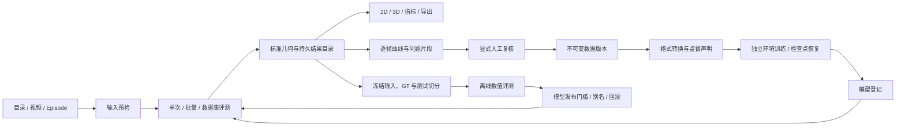

# 统一任务、评测与训练闭环

本层扩展 MINT 平台，原 HaWoR、ACE 安装作为只读算法依赖。发布的数值结果保持不可变；数据清单、训练环境、模型版本和缓存均保存在 MINT 内。

## 页面如何连接



- **任务中心** 汇总推理、批次、评测、渲染、同步导出、数据与训练任务。阶段记录包含归属、父级比较、执行尝试、等待原因、阶段耗时和可用时的阶段 ETA。
- **结果目录** 在服务重启后仍可搜索发布几何、保存的 CLI 预测、窗口缓存、评测协议、复核记录、数据与模型版本。窗口缓存和完整预测分别标明用途；已有数值导入不会运行网络。
- **质检与复核** 选择比较和预测，可附加 GT 或另一算法。曲线提供关节差异、重投影差异和腕部加速度，候选片段可跳转到原帧。无 GT 的差异、存在性缺失和运动突变只作为复核线索。
- **数据与训练** 提供已有相机标签转换、复核相机伪标签导出、环境预检、Ray 任务入口、训练、严格续训、模型登记与评测门槛。专业工作台也有这一入口。

## 任务与恢复

`platform_tasks` 是 SQLite 持久索引，`platform_events` 保存状态与阶段变化。分页和搜索在数据库执行；源执行器仍负责真实状态。任务页不会把心跳陈旧直接判为失败，也不会终止外部进程。旧工作台的内存任务会保存观察快照，原进程退出后显示中断和重新提交入口。

| 类型 | 服务重启后的策略 |
|---|---|
| 原生推理 | 原有归属检查、窗口/片段/阶段缓存；明确恢复，已完成结果不重新计算 |
| 批量与数据集评测 | 持久输入及协议；自动继续未完成项，取消保护共享运行 |
| 同步视频导出 | 持久完整请求、输入身份、尝试与归属；死进程的任务自动从帧零重放，只原子发布完整视频 |
| 仿真渲染 | 已有独立进程与请求；中断后明确重试 |
| 训练 | 父进程退出时停止自有训练子进程，保留完整检查点；显式恢复模型、优化器、调度器、RNG 和步数 |

导出被用户取消后不会因重启而自动执行。旧版本没有完整请求的排队导出会标记为中断，需要重新提交。崩溃留下的半成品视频被转为普通受限缓存，参与配额回收，历史任务记录保留。

训练检查点先写临时目录，全部进程保存完毕后才发布 `step_*/checkpoint.json`。恢复前核对记录中的文件身份。空间保留或检查点配额不足时保留已有完整版本并停止写新版本，不自动删除模型历史。

## 预检、资源和性能口径

单次、批量、评测、数据和训练入口均有预检。视频检查帧范围、视角、标定、GT、后端就绪、ACE 长度约束和磁盘估算。默认处理完整选定范围；MINT 的窗口长度不等于视频帧数上限。

运行优先级为交互、批量、后台；等待较久的任务逐步提升优先级。合作 GPU 租约可在已完成窗口/片段边界给更高优先级任务让步。该机制不终止其他用户进程，也不构成硬件隔离。连续 SLAM 阶段有时序依赖。DDP 训练一个尝试内保持固定 GPU 数，严格恢复要求相同 world size。

任务中心显示物理 GPU、主机 CPU/RAM 和磁盘。结果清单还保存模型加载、共享输入准备、阶段壁钟、GPU 峰值、共享让步以及 Linux 工作进程/已回收子进程的 CPU、RSS 和物理块 IO。阶段 ETA 是估算；并行进程的计算时间不能直接相加当作端到端耗时。

| 缓存模式 | 行为 |
|---|---|
| `exact` | 相同运行身份复用；保留既有窗口与阶段恢复机制 |
| `compatible` | 仅在输入、后端和数值参数相同且文件校验通过时引用已完成原生结果；资源策略和 GPU 上限不改变几何 |
| `fresh` | 新运行身份，关闭 MINT 窗口预测及 HaWoR 跨运行阶段复用；共享 RGB 准备仍独立计时 |

兼容复用引用原运行，不复制或重新命名数值产物；卡片会标识复用，原 GPU/耗时证据保留原义。模型在单个原生阶段内复用，空闲、资源压力、优先级让步或阶段结束后释放；未建立跨后端常驻模型服务。

## 评测、数据和模型门槛

冻结协议记录输入身份、帧范围、标定信息、唯一声明 GT、数据切分与标签。相同来源/Episode 不能出现在不同切分。离线评测接受现有原生或导入结果，按关节/手/相机样本数加权，缺少或失败的预测保留在覆盖率分母中，不宣称冷启动性能或复现论文榜单。

评测采用运行时冻结的权重身份。覆盖同路径权重文件不会使旧预测成为新模型的评测。发布别名还核对实际推理配置、图像尺寸、窗口长度、评测源、几何完整性、误差和覆盖门槛，以及已声明训练数据与测试输入的重叠。回滚使用先前通过的门槛，重新检查文件仍可用。已评测别名可在 MINT 参数浏览器中选择；更新别名不改写默认权重文件或正在执行的模型。

复核清单是数据筛选版本。导出相机训练数据时要求有限、有效的世界相机轨迹和适用的中心针孔模型。预测轨迹明确标为相机伪标签，不自动变成 GT，也不补造 MANO 标签。已有 LeRobot 相机标签转换保留来源、Episode 和视频偏移；本路径仅提供相机监督。

## 独立环境与验证配方

```bash
.venv/bin/python scripts/setup_platform_environment.py --profile train
.venv/bin/python scripts/setup_platform_environment.py --profile qa
```

安装器在 `.environments/training` 或 `.environments/platform-qa` 创建环境，读取现有推理依赖并将新增包安装到独立环境，保存环境清单。正式推理环境和外部算法环境不改动。训练任务关闭外部日志上传，保留本地配置、代码与训练日志。

正式配方仍为 `configs/training/mint_step1.yaml` 和 `mint_step2.yaml`。功能验证使用 `configs/validation/mint_camera_smoke.yaml`：112×112、4 帧窗口、一个优化器步，只用于验证数据加载、梯度、状态保存和恢复，不能证明模型质量提升。CLI `--max-steps` 优先于 epoch 设置。

主要运行配置：

| 配置 | 用途 / 默认值 |
|---|---|
| `MINT_COMPARISON_DIR` | 持久任务、目录、结果与研究记录根目录 |
| `MINT_CACHE_MIN_FREE_GIB` | 磁盘保留空间，16 GiB |
| `MINT_COMPARISON_EXPORT_MAX_GIB` | 同步视频缓存，16 GiB |
| `MINT_NATIVE_WARM_SECONDS` | 原生阶段内模型空闲驻留，默认 180 秒，限制在 1–300 秒 |
| `MINT_TRAIN_CHECKPOINT_MAX_GIB` | 单训练输出目录检查点配额，128 GiB，可按存储调整 |

## 当前外部边界

原生 Ray 重建数据生产仍需要其适配源码、GeoCalib/MoGe/Mega-SAM 等资产和相应独立依赖；预检会列出缺项。新增的已有标签转换和复核相机数据导出路径可以独立使用。生产训练还需指定正式数据与初始化资产。

多机配置可以校验节点、rank、world size、共享路径和启动参数，并保存待验收条件。实际跨机 NCCL、共享存储、云工作区/资源/镜像需在真实环境验证，本模块不申请云资源或启动未经配置的远程任务。可能改变数值的加速或融合先形成独立实验记录，保留完整帧、原生基线、误差与耗时条件，不由验证记录自动启用。

训练启动和独立环境方式参考 [Accelerate 官方安装文档](https://huggingface.co/docs/accelerate/basic_tutorials/install) 与 [启动文档](https://huggingface.co/docs/accelerate/basic_tutorials/launch)，使用项目固定版本。
